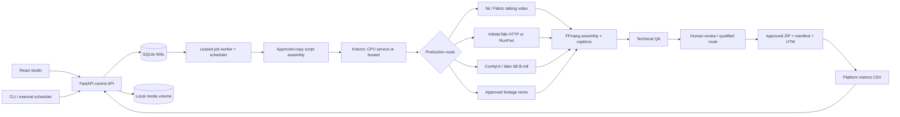

# Architecture

The application is a single-workspace control plane. It deliberately does not keep a heavy model in the API process. A 5070 can spend its VRAM on video while the API, scripts, speech and editing run on CPU or remote inference.

## Source layout

| Module | Responsibility |
| --- | --- |
| `config.py` | Environment, data locations, mode, caps |
| `schemas.py` | Validated product, creator, batch, review and metrics inputs |
| `db.py` | WAL schema, transactions, job leases, seeds |
| `service.py` | Batch validation, quote, deterministic experiment assignment |
| `creative.py` | Claim-grounded scripts, cache keys, caption text |
| `accounting.py` | Atomic daily/batch reservations and reconciliation |
| `providers.py` | Hosted fal queue, RunPod queue, voice, ComfyUI, avatar HTTP, shared cache |
| `workflows.py` | Core-only ComfyUI API graph |
| `render.py` | Normalize shots, deterministic remixes, subtitles, final encode, QA |
| `worker.py` | Scheduler, heartbeat, stage execution, error classification |
| `analytics.py` | Observed funnel metrics and contribution economics |
| `main.py` | Same-origin API, authorization, uploads, review, export |

## Queue and recovery

Jobs are claimed with `BEGIN IMMEDIATE` and assigned an owner and 120-second lease. Independent heartbeat threads renew leases every ten seconds. Stale jobs return to the queue. Stage boundaries check ownership and cancellation. The default is one job at a time.

There is no global exactly-once guarantee across an external paid API. The implementation instead preserves the practical invariant: **once a provider request might have been accepted, it is not silently submitted again**. A pre-submission intent is stored in `requests`. A response stores polling/result IDs. A process dying between them leaves a visible attention state. Manual reconciliation resolves uncertainty.

A worker dying during FFmpeg may leave a partial local output. Retrying overwrites that job's generated filenames. Cached stages are returned only when the referenced file exists. Inference caches are keyed by relevant content, identity, model and seed. Model configuration is snapshotted into each job; the provider may still update an aliased hosted endpoint externally.

SQLite and the filesystem do not form one atomic transaction. Export only accesses completed reviewed jobs, and files are written before completion is recorded. Back up at a quiet boundary. A future multi-host version should move artifacts to versioned object storage and use a database/outbox designed for that deployment.

## Costs

`spend` retains reserved and committed estimates and actual invoice reconciliations. Cost reservation is atomic relative to both caps, not relative to a cloud bill. The reserve ID is stable per inference key; recovering a submission does not add another identical reserve. A deliberately retried failed request archives its previous request/cost before reserving another attempt, preserving failure economics.

Shared cache costs are attributed to their first generating job. This is explicit; it is not a sophisticated amortization ledger. It makes total production cost useful but can bias comparisons between one cold batch and later warm batches. Benchmark cold/warm runs separately.

## Security and deployment boundaries

The browser receives no provider keys. Protected API/media routes accept a shared bearer token or an HttpOnly same-site cookie. Writes check Origin against Host. With no workspace token, only loopback/test hosts are accepted. Default Compose binds the studio and standalone inference workers to loopback. Uploads have bounded file sizes, internal names and type validation. Generated subtitle control characters are sanitized. Provider downloads are restricted to trusted HTTPS fal media hosts.

This is not a user-account or tenant-isolation system. Use private access for your business team. A public SaaS needs separate identities, per-user authorization, encrypted secret management, audit retention and infrastructure controls appropriate to that product.

## Add another model

1. Add a model ID and its capability/rate/license metadata to `registry.py` and the `ModelID` schema. Distinguish talking generation, B-roll and editing.
2. Add the provider-specific input/output mapping in `providers.py`. Use a persistent request key and reservation before any paid submission. Preserve ambiguous states instead of retrying a network POST blindly.
3. Return `(local_media_path, metadata, cache_hit)` from the generation adapter. Download and validate completed media before caching it. Keep secrets in backend environment variables.
4. Route the capability in `worker.py`; snapshot its configuration in `service.py`. A new configuration naturally requires new quality qualification.
5. Add contract tests with mocked network responses, then a small **paid, explicitly chosen** hardware/provider smoke test. Record runtime, configuration, bill and acceptance results. Do not label an unexecuted adapter production-verified.

To add word-level captions, introduce an alignment adapter after speech, emit exact cue start/end times, and feed them to `render.subtitles`; preserve the current approximate fallback and expose which method produced the cues. To add publishing, build a separate connector using official platform APIs, explicit account authorization, disclosure controls and idempotent posting keys. No unofficial posting/scraping package is included.
